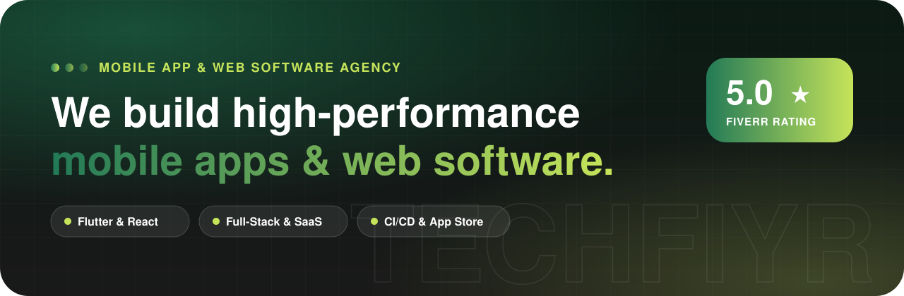
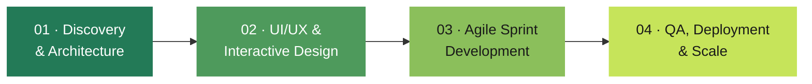
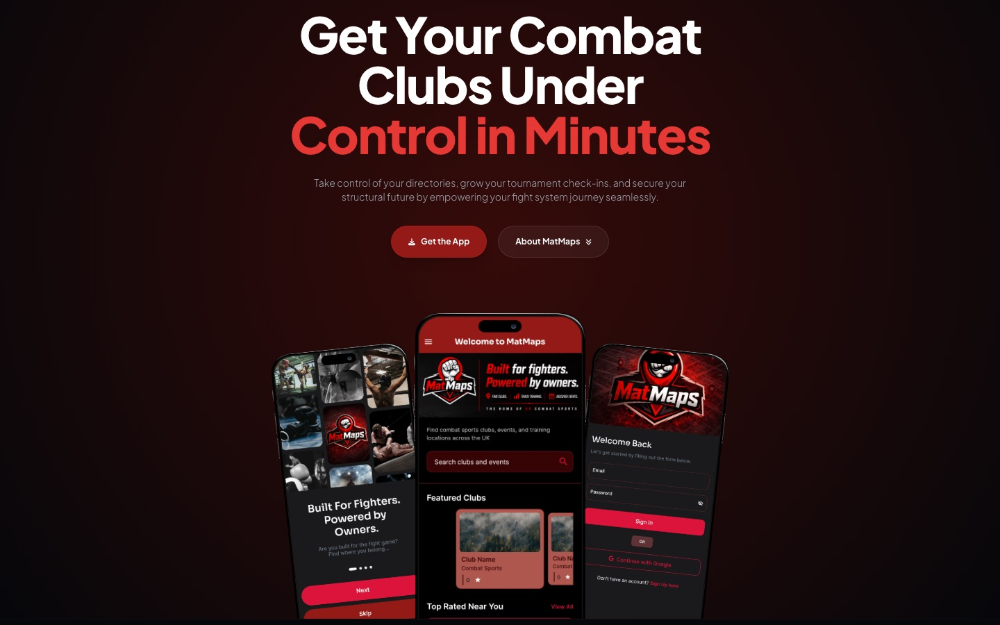
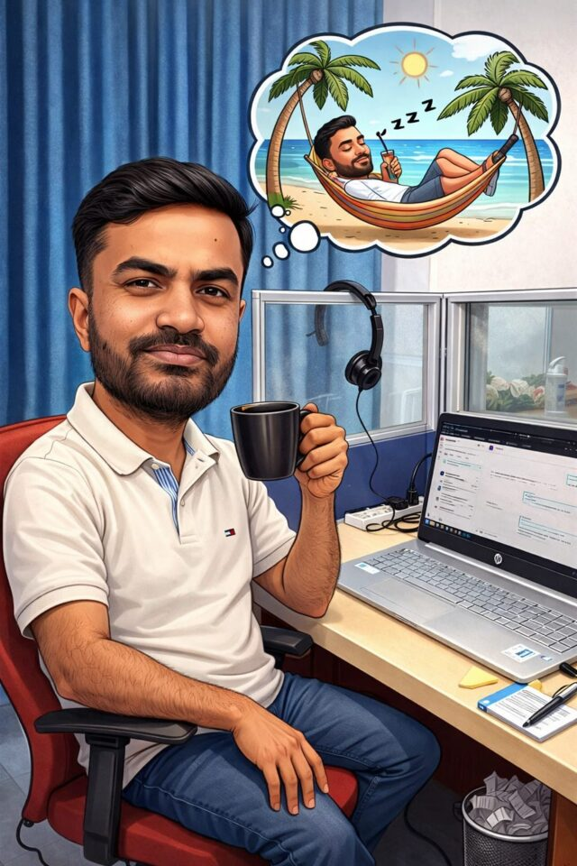

<div align="center">

<a href="https://techfiyr.com">
	<picture>
		<source media="(prefers-color-scheme: dark)" srcset="public/assets/images/brand/logo-white.svg">
		
	</picture>
</a>

<br><br>

<a href="https://techfiyr.com"></a>

<br><br>

<a href="https://techfiyr.com"></a>
<a href="https://techfiyr.com/contact"></a>
<a href="https://www.fiverr.com/wahidsaurav"></a>
<a href="https://www.upwork.com/freelancers/sauravwahid"></a>

<h3>From first prototype to App Store launch.</h3>

<p><b>TechFiyr</b> is a mobile app and web software agency in Dhaka, Bangladesh, helping startups<br>and growing businesses across the US, Europe and Asia design, build and ship digital products.</p>

</div>

<br>

## ✦ By the numbers

<div align="center">

| <h2>20</h2> | <h2>5.0 ★</h2> | <h2>2+</h2> | <h2>5</h2> |
|:---:|:---:|:---:|:---:|
| Happy clients across<br>the US, Europe & Asia | Average client rating<br>on Fiverr | Years shipping mobile<br>& web products | Core designers<br>& developers |

</div>

<br>

## ✦ What we offer

<table>
	<tr>
		<td width="50%" valign="top">
			<h3>📱 Mobile App Design & Development</h3>
			<p>Cross-platform and native apps that feel fast and look sharp, shipped to both stores.</p>
			
			
			
			
		</td>
		<td width="50%" valign="top">
			<h3>💻 Custom Web Software & SaaS</h3>
			<p>Scalable web platforms, admin dashboards and cloud SaaS products built on a modern stack.</p>
			
			
			
			
		</td>
	</tr>
	<tr>
		<td width="50%" valign="top">
			<h3>🎨 UI/UX & Product Prototyping</h3>
			<p>Pixel-perfect Figma prototypes and design systems that keep users engaged.</p>
			
			
			
			
		</td>
		<td width="50%" valign="top">
			<h3>☁️ Backend, Cloud & CI/CD Pipelines</h3>
			<p>Secure APIs, cloud infrastructure and automated release pipelines, so shipping is one click.</p>
			
			
			
			
		</td>
	</tr>
</table>

<br>

## ✦ How we work: idea to App Store in 4 steps



| Step | What happens |
|---|---|
| **01 · Discovery & Architecture** | We map your requirements and user journeys, and plan a scalable technical foundation. |
| **02 · UI/UX & Interactive Design** | Modern Figma prototypes and user-centred design systems. |
| **03 · Agile Sprint Development** | Clean, modular code with Flutter, React and Next.js, and secure APIs. |
| **04 · QA, Deployment & Scale** | End-to-end testing, App Store, Google Play and cloud releases, and post-launch support. |

<br>

## ✦ Featured work

<table>
	<tr>
		<td width="45%"><a href="https://techfiyr.com/projects/matmaps"></a></td>
		<td valign="top">
			<h3>MatMaps</h3>
			<p>A UK combat sports platform that helps athletes find clubs and events, and gives gym owners the tools to run their club, on Android and the web.</p>
			<p>Geo-located club directory · events & bookings · round timers · role-based access · subscriptions</p>
			<a href="https://techfiyr.com/projects/matmaps"></a>
			<a href="https://play.google.com/store/apps/details?id=com.matmaps.app"></a>
			<a href="https://matmaps.co.uk/"></a>
		</td>
	</tr>
</table>

<p align="center"><a href="https://techfiyr.com/projects"><b>See all projects →</b></a></p>

<br>

## ✦ What clients say

> **"He is the best Codemagic expert I've ever worked with!"**<br>
> <sub>theinnerpoint · 🇺🇸 United States · Verified Fiverr client · ★★★★★</sub>

> **"What stood out the most was their ability to deliver the work ahead of schedule, which was a tremendous help for our team."**<br>
> <sub>sairamchaganti · 🇮🇳 India · Verified Fiverr client · ★★★★★</sub>

> **"Absolutely awesome experience. Super fast delivery. Helped our team streamline our iOS deployment pipeline."**<br>
> <sub>jamiegale · 🇮🇪 Ireland · Verified Fiverr client · ★★★★★</sub>

<br>

## ✦ The team

<div align="center">

|  |  |  |  |  |
|:---:|:---:|:---:|:---:|:---:|
| **[Saurav Wahid](https://www.linkedin.com/in/sauravwahid/)** | **[Viswajit Roy](https://www.linkedin.com/in/viswajitroy)** | **[Ponir Saha](https://www.linkedin.com/in/ponirsaha/)** | **[Md Masud Parvez](https://www.linkedin.com/in/masudparvez11/)** | **[Md. Awon-Uz-Zaman](https://www.linkedin.com/in/awonuzzaman/)** |
| <sub>Co-Founder & Team Lead | Full Stack AI Native Engineer | Java | Spring | Web | Mobile App | DevOps</sub> | <sub>Co-Founder & Managing Director | Lead UI/UX Designer</sub> | <sub>Co-Founder & CTO | Software Architect | Production AI/RAG | Java | Spring | Python</sub> | <sub>Lead Android & iOS Developer</sub> | <sub>Android & iOS Developer</sub> |

</div>

<br>

---

## ⚙️ About this repository

This repository is the source of **[techfiyr.com](https://techfiyr.com)**: a Next.js site where every page is prerendered to static HTML and served from Netlify's CDN. Links prefetch the next page so navigation is instant, and a service worker makes the site an installable PWA that opens visited pages offline. The look and motion are the original template's own CSS and scripts. One Netlify Function powers the visitor counter.

      

### Run it locally

```bash
git clone git@github.com:techfiyr/techfiyr.git
cd techfiyr
npm install
npm run dev        # http://localhost:3000
npm run build && npm start   # production build (service worker on)
```

Netlify features (booking form submissions, headers and redirects, Google Analytics, the footer visitor counter) only work on the deployed site, or locally with `netlify dev` and a git-ignored `.env`. Environment variables are listed in [AGENTS.md](AGENTS.md), section 7.6.

### Project structure

```text
.
├── app/                             # Next.js routes (prerendered at build time)
│   ├── layout.tsx                   # <html>, icons, theme colour
│   ├── (site)/layout.tsx            # Template stylesheets, header, footer, template scripts
│   ├── (site)/page.tsx              # Home: services, about, reviews, process, team
│   ├── (site)/projects/             # Portfolio and /projects/<slug> case studies
│   ├── (site)/contact/              # Booking calendar, contact details, map
│   ├── (site)/privacy-policy · cookie-policy · content-policy
│   ├── not-found.tsx · offline/ · coming-soon/   # Stand-alone pages
│   └── manifest.ts · sitemap.ts     # /manifest.webmanifest, /sitemap.xml
├── components/                      # Header, NavMenu, Footer, PageTitle, ProjectsGrid, JsonLd, SiteRuntime
├── lib/
│   ├── site.ts                      # Company facts, nav, asset versions
│   ├── seo.ts                       # Page metadata helper
│   └── projects.ts                  # ← add or edit portfolio projects here
├── styles/                          # CSS of the stand-alone pages
├── public/                          # Static files served from the site root
│   ├── assets/
│   │   ├── css/                     # style.css (site styles), responsive.css (breakpoints)
│   │   ├── js/                      # Template behaviour and widgets: script.js, booking.js,
│   │   │                            #   consent.js, analytics.js, visitors.js
│   │   ├── vendor/                  # Third-party libraries, one folder each (see THIRD_PARTY_NOTICES.md)
│   │   ├── fonts/                   # Font Awesome webfonts
│   │   └── images/                  # brand/ hero/ backgrounds/ services/ about/ team/
│   │                                #   icons/ projects/<slug>/ og/
│   ├── sw.js                        # Service worker (PWA, offline)
│   ├── __forms.html                 # Netlify Forms registration for the booking form
│   ├── .well-known/security.txt
│   └── robots.txt · llms.txt        # Search engine and AI crawler discovery
├── netlify/functions/visits.mjs     # /api/visits: footer visitor counter (Firestore)
├── scripts/build-config.mjs         # Runs before the build: writes public/firebase-config.js from env vars
├── .github/assets/                  # README artwork (not deployed)
├── netlify.toml                     # Build, redirects from the old .html URLs, headers
├── .editorconfig · .gitattributes   # Editor and line-ending conventions
├── AGENTS.md                        # Design system, code style, accessibility and SEO rules
├── THIRD_PARTY_NOTICES.md           # Bundled libraries and their licenses
└── LICENSE
```

### Brand palette

| | Token | Hex | Use |
|---|---|---|---|
|  | `--main-color` | `#237A57` | Primary green: links, accents, buttons |
|  | `--color-two` | `#C6E45A` | Lime: gradient end, highlights |
|  | `--black-color` | `#191919` | Headings, dark sections |
|  | `--color-four` | `#F2F2F2` | Light section background |

Signature gradient: `linear-gradient(90deg, #237A57 0%, #C6E45A 100%)` · Fonts: **Outfit** (headings), **Manrope** (body), **Raleway** (outlined display words).

### Contributing

Read **[AGENTS.md](AGENTS.md)** before changing anything. It covers the design system, code style, accessibility (WCAG 2.2 AA), and the SEO/AEO/GEO rules every page must follow. Remember to bump the file's version in `ASSET_VERSION` (`lib/site.ts`) when you change a CSS or JS file in `public/assets`.

---

<div align="center">

### Have an app or web idea? Let's build it.

<a href="https://techfiyr.com/contact"></a>

📧 [info@techfiyr.com](mailto:info@techfiyr.com) · 💬 [WhatsApp +880 1540659530](https://wa.me/8801540659530) · 📍 325, Mirpur DOHS, Dhaka, Bangladesh

<a href="https://github.com/techfiyr"></a>
<a href="https://www.fiverr.com/wahidsaurav"></a>
<a href="https://www.upwork.com/freelancers/sauravwahid"></a>
<a href="https://www.linkedin.com/in/sauravwahid/"></a>

<sub>© 2026 TechFiyr. All rights reserved. · Mobile App & Web Software Agency</sub>

</div>
